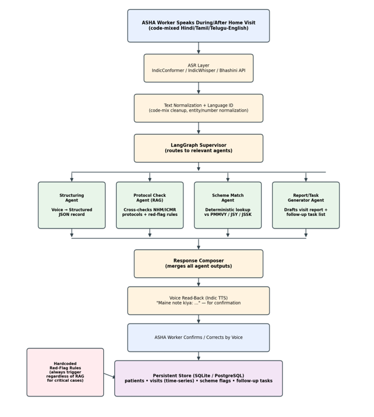

<div align="center">

# 🎙️ Voice-First ASHA Co-Pilot

### A Multi-Agent, Voice-First Decision-Support and Documentation System for Frontline Community Health Workers in India

[](https://python.org)
[](https://fastapi.tiangolo.com)
[](https://langchain-ai.github.io/langgraph/)
[](https://reactjs.org)
[](LICENSE)

**Domain:** Speech Processing · Agentic AI · Retrieval-Augmented Generation · Healthcare IT

[Overview](#-overview) · [What We Are Building](#-what-we-are-building) · [Features](#-features) · [Architecture](#-architecture) · [Project Structure](#-project-structure) · [Team](#-team) · [Documentation](#-documentation)

</div>

---

## 👥 Team
- **M ROHAN NAIDU (2023BCS0148)** — Part 1: Indic ASR for Code-Mixed Data
- **ANOUSHKA SAMANTA (2023BCS0147)** — Part 3: RAG System with Official Docs
- **ADITHYA TJ (2023BCS0195)** — Part 4: Architecture

---

## 📖 Overview

**Voice-First ASHA Co-Pilot** is an intelligent, voice-first decision-support and documentation system built for **ASHA (Accredited Social Health Activist) workers** and equivalent frontline community health workers (CHWs) who conduct home visits across rural India.

Unlike conventional "AI health chatbot" projects, this system **does not speak directly to a patient**. Instead, it assists the trained health worker: she speaks naturally, in **code-mixed Hindi/Tamil/Telugu-English**, during or immediately after a home visit, and a coordinated set of specialized AI agents:

- 🎤 Converts speech into a **structured medical record**
- 📋 Cross-checks against **NHM/ICMR clinical protocols**
- 🏥 Flags **government healthcare-scheme eligibility** (PMMVY, JSY, JSSK)
- 📝 Produces a formatted **visit report + follow-up task list**
- 🔊 Reads everything back **by voice for confirmation** before saving

> **The defining design decision:** The AI never gives advice directly to an untrained patient. The trained worker remains the decision-maker at every step.

---

## 🎯 What We Are Building

### The Problem We Are Solving

ASHA workers are the backbone of India's rural primary healthcare system. Each ASHA supports roughly **1,000 people** through home visits covering maternal health, child immunization, nutrition, and disease surveillance. Despite this critical role, several structural problems persist:

| Problem | Why It Matters |
| :--- | :--- |
| **Documentation is paper-based** | Time-use studies show a substantial share of the workday is spent on non-patient-facing administrative tasks rather than direct care |
| **Manual protocol cross-checking** | Depends entirely on the worker's memory and training, which varies widely across individuals |
| **Scheme eligibility is complex** | PMMVY, JSY, JSSK involve complex, frequently updated criteria that are easy to miss during a rushed visit |
| **Existing tools add burden** | Field studies report an expanding, not shrinking, workload after digitization |
| **AI chatbots create liability** | Hallucination and overreliance risks when AI outputs reach end-patients directly |

### What Our System Does

We are building a **voice-first, multi-agent co-pilot** that:

1. **Listens** to the ASHA worker speak naturally in code-mixed language
2. **Transcribes** her speech to text using Indic ASR models
3. **Structures** the transcript into a validated JSON medical record
4. **Checks** clinical protocols using RAG + hardcoded red-flag rules
5. **Matches** government scheme eligibility deterministically
6. **Generates** a formal visit report + follow-up task list
7. **Reads back** the summary by voice for confirmation
8. **Saves** only after the worker confirms

### What Makes It Different

| Aspect | Existing Work | This Project |
| :--- | :--- | :--- |
| **User Focus** | Patient-facing chatbots | ✅ **Worker-facing co-pilot** |
| **Input** | Text / Forms | ✅ **Voice-first, code-mixed** |
| **Safety** | LLM-only judgement | ✅ **RAG + hardcoded red flags** |
| **Eligibility** | LLM-guessed | ✅ **Deterministic rule engine** |
| **Evaluation** | Single-agent | ✅ **Multi-agent vs single-agent ablation** |

---

## ✨ Features

### 🎯 Core Capabilities

| Feature | Description |
| :--- | :--- |
| 🎙️ **Voice-First Capture** | Natural code-mixed speech input — no typing required |
| 🤖 **Multi-Agent Architecture** | 4 specialized agents coordinated by LangGraph supervisor |
| 📊 **Structured JSON Extraction** | Converts free-form speech to schema-validated medical records |
| 🛡️ **Hybrid Safety Design** | RAG-grounded protocols + hardcoded red-flag rules |
| 🏥 **Deterministic Scheme Matching** | Rule-based eligibility (not LLM guessing) for PMMVY/JSY/JSSK |
| 🔊 **Voice Read-Back Confirmation** | Summary read back in regional language before saving |
| 📄 **Automated Visit Reports** | Formal reports + follow-up task lists |
| 📈 **Analytics & Evaluation** | WER, F1, Precision/Recall, Ablation Study |

### 🔬 Technical Highlights

| Layer | Tool | Purpose |
| :--- | :--- | :--- |
| **ASR** | IndicWhisper / IndicConformer / Bhashini API | Transcribe code-mixed Indic speech |
| **TTS** | Bhashini TTS / Coqui TTS | Natural regional-language read-back |
| **Orchestration** | LangGraph | Multi-agent state graph |
| **LLM** | Llama-3 via Ollama / Groq free tier | Structuring, protocol, report |
| **Vector DB** | ChromaDB / FAISS | Store and retrieve protocol chunks |
| **Embeddings** | sentence-transformers | Embed protocol text + queries |
| **Database** | SQLite / PostgreSQL | Patients, visits, scheme flags, tasks |
| **Backend** | FastAPI | Wire ASR → agents → TTS |
| **Frontend** | React / Next.js | Mic input, visit history, task list |
| **Schema** | Pydantic | Enforce structured JSON output |

---

## 🏗️ Architecture

### System Pipeline




### Agent Responsibilities

| Agent | Responsibility | Primary Tool |
| :--- | :--- | :--- |
| **Supervisor Agent** | Classifies intent, routes to relevant agents | LangGraph state graph |
| **Structuring Agent** | Converts speech → validated JSON medical record | LLM few-shot + Pydantic |
| **Protocol Check Agent** | Retrieves NHM/ICMR protocols, flags escalations | RAG (ChromaDB) + hardcoded rules |
| **Scheme Match Agent** | Matches household against PMMVY/JSY/JSSK | Deterministic SQL/rule engine |
| **Report Generator Agent** | Drafts visit report + follow-up tasks | LLM generation |
| **Response Composer** | Merges all agent outputs into one summary | LLM synthesis |
| **TTS Layer** | Converts summary → regional-language speech | Bhashini / Coqui TTS |

---

## 📁 Project Structure

```
asha-copilot/
│
├── backend/
│   ├── main.py                          # FastAPI entry point 
│   │
│   ├── agents/
│   │   ├── __init__.py
│   │   ├── supervisor.py                # LangGraph supervisor
│   │   ├── structuring_agent.py         # Speech → JSON 
│   │   ├── protocol_check_agent.py      # RAG + red flags 
│   │   ├── scheme_match_agent.py        # PMMVY/JSY/JSSK rules 
│   │   ├── report_generator.py          # Report + tasks 
│   │   └── response_composer.py         # Merge outputs 
│   │
│   ├── asr/
│   │   ├── __init__.py
│   │   ├── transcriber.py               # IndicWhisper/Conformer 
│   │   └── preprocessor.py              # Audio preprocessing
│   │
│   ├── tts/
│   │   ├── __init__.py
│   │   └── synthesizer.py               # Bhashini/Coqui TTS 
│   │
│   ├── rag/
│   │   ├── __init__.py
│   │   ├── embeddings.py                # Sentence transformers 
│   │   └── retriever.py                 # ChromaDB retrieval 
│   │
│   ├── rules/
│   │   ├── __init__.py
│   │   ├── red_flags.py                 # Hardcoded rules 
│   │   └── schemes.py                   # PMMVY/JSY/JSSK rules 
│   │
│   ├── db/
│   │   ├── __init__.py
│   │   ├── models.py                    # SQLModel models 
│   │   └── database.py                  # SQLite/PostgreSQL
│   │
│   └── schemas/
│       ├── __init__.py
│       └── medical_record.py            # Pydantic schemas
│
├── frontend/
│   ├── src/
│   │   ├── components/
│   │   │   ├── MicInput.jsx             # Mic recording 
│   │   │   ├── VisitHistory.jsx         # Past visits 
│   │   │   ├── TaskList.jsx             # Follow-up tasks
│   │   │   └── ReportView.jsx           # Report display
│   │   ├── App.jsx                      # Main app
│   │   └── main.jsx                     # Entry point
│   └── package.json
│
├── data/
│   ├── guidelines/                      # NHM/ICMR PDFs
│   ├── schemes/                         # Scheme rules 
│   └── evaluation/                      # Test set 
│
├── evaluation/
│   ├── metrics.py                       # WER, F1, etc.
│   ├── ablation.py                      # Multi vs single agent
│   └── results/                         # Evaluation outputs 
│
├── docs/
│   ├── architecture.md                  # System design
│   ├── setup.md                         # Setup guide
│   └── evaluation.md                    # Evaluation plan 
│
├── requirements.txt                     # Dependencies 
├── docker-compose.yml                   # Docker setup 
└── README.md                            # Documentation 
```

### Datasets Used

| Dataset | Purpose | Source |
| :--- | :--- | :--- |
| **IndicVoices** | ASR training / evaluation | [AI4Bharat](https://github.com/AI4Bharat/IndicVoices) |
| **CoSTA** | Code-mixed speech evaluation | [arXiv:2406.10993](https://arxiv.org/abs/2406.10993) |
| **NHM Guidelines** | Protocol RAG grounding | [nhm.gov.in](https://nhm.gov.in) |
| **ICMR Guidelines** | Clinical protocols | [icmr.gov.in](https://icmr.gov.in) |
| **Haqdarshak Data** | Scheme eligibility evidence | [Harvard Dataverse](https://dataverse.harvard.edu) |

### Base Research Papers

| Paper | Usage |
| :--- | :--- |
| **ASHABot** (arXiv:2409.10913) | Primary base reference |
| **Orchestrator CDSS** (arXiv:2512.04207) | Multi-agent architecture |
| **CoSTA** (arXiv:2406.10993) | Code-mixed speech eval |
| **Health-Pariksha** (arXiv:2410.13671) | RAG evaluation methodology |
| **IndicVoices** (arXiv:2403.01926) | Indic speech dataset |
| **Designing with Culture** (arXiv:2509.15575) | Trust & cultural norms |

---

## 🙏 Acknowledgements

- [TensorFlow Object Detection API](https://github.com/tensorflow/models)
- [AI4Bharat](https://ai4bharat.org/) for Indic speech resources
- [LangChain / LangGraph](https://langchain-ai.github.io/langgraph/) for multi-agent orchestration
- [ChromaDB](https://www.trychroma.com/) for vector storage
- [FastAPI](https://fastapi.tiangolo.com/) for the backend framework
- [National Health Mission](https://nhm.gov.in) and [ICMR](https://icmr.gov.in) for clinical guidelines

---

<div align="center">

**Made with ❤️ at IIIT Kottayam**

*Empowering India's frontline health workers with AI*

</div>

